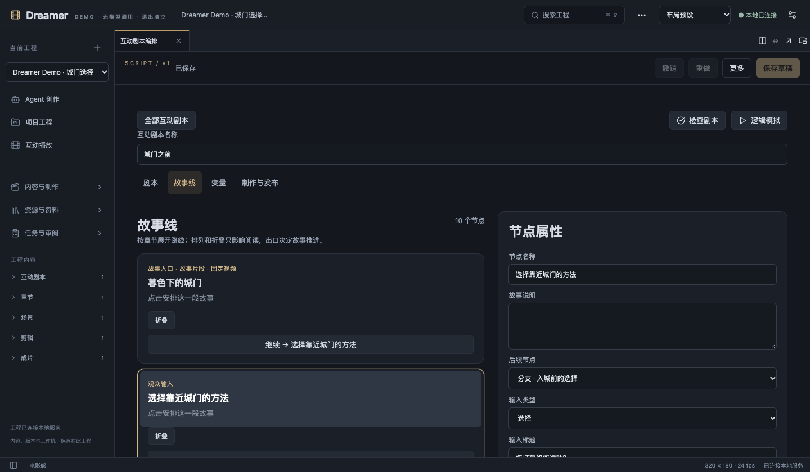
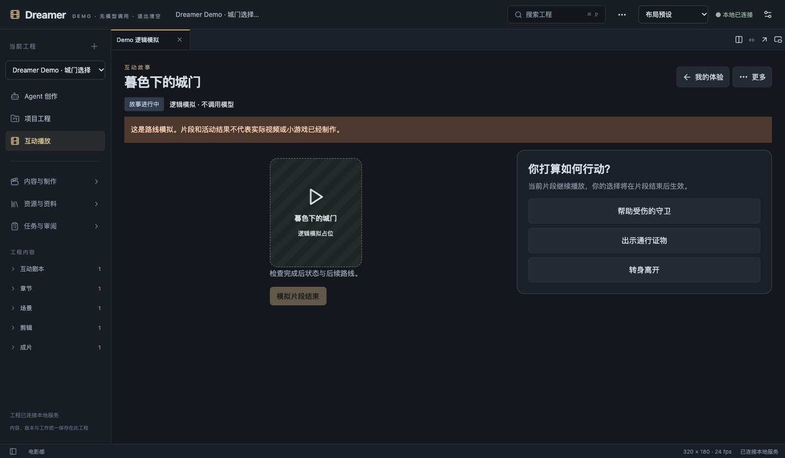
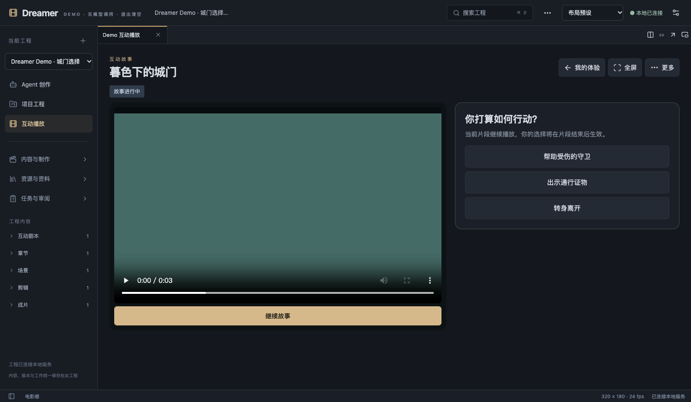

# Dreamer

**在本地，把一个故事从想法写到可以观看和互动的作品。**

Dreamer 是面向作者的创作工作台：章节、剧本、设定、分镜、素材、剪辑和审阅共用同一个工程。你可以通过平台写作 Agent 共同构思、续写和修订，也可以给故事编排选择、分支与独立存档。

[快速体验](#快速体验无需-key) · [Codex / Agent 接入](#本地-codex--其他-agent-快速接入) · [本地开发](docs/local-development.md) · [文档](docs/README.md) · [贡献](CONTRIBUTING.md)

- **本地保存**：工程与凭据保存在自己的机器上，基础工作台无需云端账号。
- **可审阅的创作**：固定内容版本，保留执行记录；修改提案由作者决定是否采用。
- **互动故事**：编排选择、路线、播放与个人存档，支持无模型的逻辑模拟。
- **按需接入模型**：写作、图像和视频服务单独配置；Demo 不会启动真实模型或付费请求。

当前为早期版本，已验证 macOS 上的工作台与两种 Demo。H3 / LTX Worker 属于实验功能，需要独立配置环境与模型。项目采用 [Apache-2.0](LICENSE)，第三方来源与许可见 [THIRD_PARTY_NOTICES.md](THIRD_PARTY_NOTICES.md)。



*互动剧本编排：在同一工程中安排故事片段、观众输入、分支和结局。画面使用内置“城门选择”样例。*

## 快速体验：无需 Key

准备 **Node.js 24.14–24.x** 和 npm；使用 nvm 的开发者可在仓库目录运行 `nvm use`。

```sh
git clone https://github.com/Dragonwarri0r/dreamer.git
cd dreamer
npm ci
npm run demo
```

打开终端输出的**完整链接**，默认端口为 `4326`。“城门选择”样例会自动装入：选择行动，点击“模拟片段结束”，沿路线抵达结局。也可以从导航查看章节和互动剧本。

| 入口 | 可以体验什么 | 额外条件 |
|---|---|---|
| `npm run demo` | 无 Key 的故事选择、路线和结局模拟 | 无需 Codex、Python、GPU 或模型 |
| `npm run demo:media` | 本地 FFmpeg 视频播放、视频内选择和结局 | FFmpeg / ffprobe，通常随 npm 依赖安装 |

两种 Demo 默认使用同一端口，先按 `Ctrl+C` 关闭，再启动另一种。媒体 Demo 的画面是合成色块，不是 AI 生成样片。

Demo 每次使用独立临时数据，忽略 `DREAMER_DATA_ROOT`，正常退出后清理；需要保留创作请使用下方的持久工作台。依赖安装需要网络，FFmpeg 安装脚本可能额外下载二进制。Linux 完整媒体工作流和回归还需中文字体与完整 FFmpeg，安装命令见 [快速开始](docs/quickstart.md#linux-媒体与字体)。

<details>
<summary>查看两种 Demo 的界面截图</summary>

**逻辑模拟**：选择行动，手动结束片段，检查故事如何进入后续路线。



**互动播放**：在视频播放期间选择行动；下图的本地 FFmpeg 色块视频用于演示播放与选择的时序。



截图来自隔离的内置样例，不含个人工程或账户配置。[截图来源与更新说明](docs/images/README.md)。

</details>

## 本地 Codex / 其他 Agent 快速接入

**维护代码的 Agent**：先读取 [AGENTS.md](AGENTS.md) 和 [本地调试](docs/local-development.md)，完成修改后运行 `npm run check` 与 `npm run source:check`。

**调用创作能力的 Agent**：使用 Dreamer 的 stdio MCP。先在仓库根目录启动持久工作台：

```sh
npm run build
npm start
```

打开 `http://127.0.0.1:4327` 创建工程，保持 Host 运行。另开终端，在仓库根目录注册到本地 Codex：

```sh
codex mcp add dreamer-writing \
  --env DREAMER_URL=http://127.0.0.1:4327 \
  --env DREAMER_NODE_BIN="$(command -v node)" \
  --env DREAMER_WRITING_CLIENT_ID=codex-local \
  -- /bin/sh "$PWD/scripts/dreamer-writing-mcp.sh"
codex mcp get dreamer-writing
```

先确认 `node --version` 满足要求。显式 Node 路径可以避免桌面客户端未加载 nvm；更换 Node 安装位置后需要更新该配置。重新连接 MCP 或新开客户端会话，然后让 Agent：

1. 调用 `dreamer_writing_projects` 确认目标工程。
2. 用 `dreamer_writing_start` 开始，已有会话用 `dreamer_writing_continue` 继续。
3. 用 `dreamer_writing_status` 查看结果；结果不明确时查询原请求回执，避免重复生成。

可以直接告诉 Agent：

> 先列出 Dreamer 工程，确认目标后讨论故事方向。本轮只讨论，不写正文；后续继续使用同一会话。

其他支持本地 stdio MCP 的 Agent 可使用 [JSON 示例](config/examples/dreamer-writing.mcp.json)；Codex 手工配置见 [TOML 示例](config/examples/dreamer-writing.codex.toml)。将示例中的脚本和 Node 路径换成自己的绝对路径。配置格式参考 [Codex 官方 MCP 文档](https://learn.chatgpt.com/docs/extend/mcp?surface=cli)。

列工程和查状态不调用模型。真实写作由 Dreamer 内部 Agent 执行，需要 Host 所在机器的兼容 Codex CLI 及用户自己的登录；无需云视频 Key。Demo 禁用真实写作。模式、固定引用与恢复流程见 [平台写作文档](docs/platform-writing.md)。

## 保存自己的创作

在已安装依赖的仓库目录运行 `npm run build`、`npm start`，打开 `http://127.0.0.1:4327`。工程默认保存到 `data/workspace`，重启后仍然保留。

需要自定义端口或数据目录时，首次复制模板并编辑：

```sh
cp .env.example .env.local
# 编辑 .env.local 中的端口、数据目录等配置
npm run start:local
```

已有 `.env.local` 时直接编辑，避免覆盖。只有 `start:local` 自动读取这个文件；`npm start` 和 `npm run dev` 使用 shell 环境变量。

Host 仅监听本机回环地址，当前适用于单用户本地使用。修改前端后重新 `npm run build` 并刷新页面，修改 Host 后重启；`npm run dev` 不提供 HMR。环境变量与断点调试见 [配置](docs/configuration.md) 和 [本地开发](docs/local-development.md)。

## 能力与依赖

| 能力 | 使用条件 |
|---|---|
| 工程、章节、设定、分镜、审阅与 TXT 导出 | 基础工作台即可使用 |
| 互动剧本、选择、路线与存档 | 逻辑模拟无需模型；播放模式需绑定已完成媒体 |
| 写作、续写、修订与独立审稿 | 本机 Codex CLI 与用户自己的登录 |
| 剪辑、预演、MP4 与路线导出 | FFmpeg / ffprobe |
| 互动运行时文本理解与生成 | 显式启用本机文本服务或 Codex，配置预算 |
| H3 / LTX 本地媒体生成 | 实验功能：独立 Worker、运行时与模型资产 |
| 云端视频与图像 | 用户自有服务、Key 及明确生成授权，可能计费 |

源码不包含模型权重、FFmpeg 可执行文件、个人登录状态、作品数据库或真实生产媒体。模型、依赖与用户作品分别遵循各自授权；工程测试通过不代表真实模型内容质量通过。

## 开发、检查与贡献

```sh
npm run check          # 类型、单元/集成测试、构建和模块边界
npm run source:check   # 公开白名单、敏感路径、工作区与暂存区内容检查
npm audit             # 查询当前依赖漏洞，需要联网
```

普通检查使用隔离数据，不调用真实模型。浏览器验收需要本机 Chrome；`test:agent`、`test:provider`、`test:creative`、`test:h3` 等真实生成入口会使用账户额度或本地算力，运行前先阅读说明。

个人配置与作品应留在 Git 忽略范围内。新增公开文件时更新 `config/public-source.json`；提交前运行 `source:check`，暂存后再运行一次。需要独立源码副本时：

```sh
npm run source:export -- /absolute/new-directory/dreamer-public-review
```

导出只复制审核范围内的文件，不跟随符号链接。完整规则见 [贡献说明](CONTRIBUTING.md) 和 [安全说明](SECURITY.md)。功能建议和可复现问题可提交到 [Issues](https://github.com/Dragonwarri0r/dreamer/issues)。

## 文档与目录

[快速开始](docs/quickstart.md) · [配置](docs/configuration.md) · [平台写作](docs/platform-writing.md) · [本地开发](docs/local-development.md) · [文档索引](docs/README.md)

| 目录 | 内容 |
|---|---|
| `apps/studio` | React 工作台与浏览器客户端 |
| `apps/host` | 本地 HTTP 服务、写作入口与应用装配 |
| `packages/contracts` | 数据与命令契约 |
| `packages/core` | 领域规则与受控 Agent 工具 |
| `packages/infra` | SQLite、媒体与模型适配器 |
| `workers` | 可选本地媒体执行器 |
| `tests` / `scripts` | 测试、Demo 与维护工具 |

## 许可证

Dreamer 采用 [Apache License 2.0](LICENSE)。第三方许可、版权声明与适配来源见 [NOTICE](NOTICE)、[第三方清单](THIRD_PARTY_NOTICES.md) 和 [许可副本](docs/licenses/README.md)。
